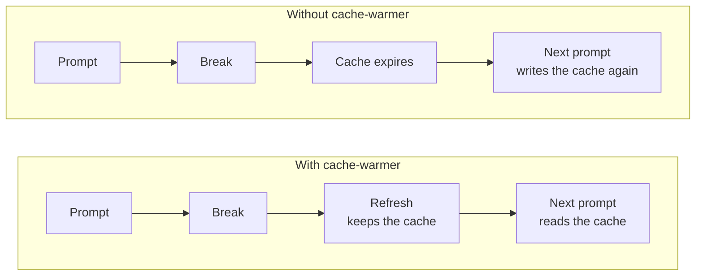
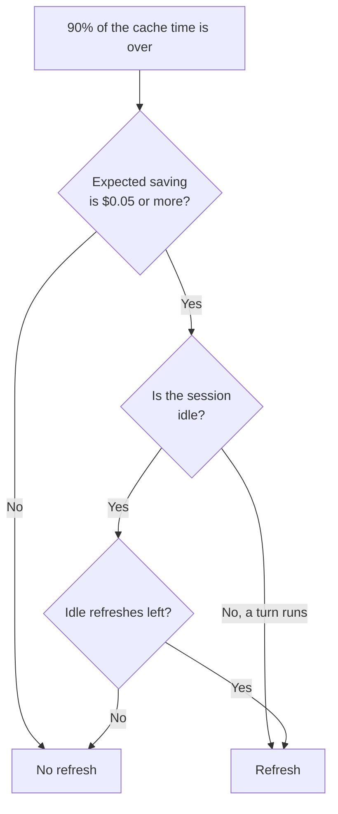

<div align="center">

<picture>
  <source media="(prefers-color-scheme: dark)" srcset="assets/clawd-dark.gif">
  
</picture>

# cache-warmer

**Keeps the Claude Code prompt cache warm during a break, so your next prompt costs less.**

[Blog post](https://blog.paulbkim.dev/cache-warmer/) · [Website](https://paulbkim.dev) · [X](https://x.com/paulbkimdev)

English · [한국어](README.ko.md) · [简体中文](README.zh-CN.md)

</div>

<br>

## What does it do?

Each prompt sends the full conversation to the API.
The API keeps the start of the conversation in a **prompt cache** for 5 minutes or 1 hour.
A prompt that reads the cache costs much less and starts faster.
After the cache expires, the next prompt writes the full cache again at a higher price.

cache-warmer sends one small **refresh** shortly before the cache expires, so the cache stays warm.
It works like the cache warmer in [Pi](https://github.com/earendil-works/pi).



<br>

## Install

This fork extends [Paul B. Kim's cache-warmer](https://github.com/paulbkim-dev/claude-code-cache-warmer). To try this checkout, run from its root:

```sh
claude --plugin-dir "$PWD"
```

This loads the local plugin for that launch. Use a session without another installed copy enabled. It does not install this fork or change global settings.

The original project's marketplace commands install the **upstream release**, without this fork's Compact Guard:

```sh
claude plugin marketplace add paulbkim-dev/claude-code-cache-warmer
claude plugin install cache-warmer@claude-code-cache-warmer
```

Restart Claude Code, then type `/cache-warmer` to open the pane.
To stop all warming, run `claude plugin disable cache-warmer`.

<br>

## What you see

During a refresh, a band above the prompt shows Clawd, the Claude Code mascot, beside a notice that the mod is resending the cached prompt.
It shows the cache time in color (`5m` cyan, `1h` magenta), the refresh interval, and the outcome: yellow while the refresh runs, green when the cache is warm, and red when it expired or failed.
A failed refresh names the API error and its status, such as `rate_limit 429`.
During a turn, the band goes 5 seconds after the refresh.
In an idle session it stays until your next prompt, with Clawd still after 5 seconds.
The pane's main page shows Clawd too.

- An ordinary fork refresh never enters the conversation. The transcript keeps one notice row per refresh, starting with ☕, and no request sends it to the model. The optional Compact Guard below uses a visible main-thread turn instead.
- The band has three styles, set on the Configuration page or in the `/config` row `cache-warmer.band`: `default` shows Clawd beside the notice, `simplified` shows the notice as one line, and `off` hides the band.
- Each refresh request starts with `[cache-warmer]`, so a request log or proxy can tell it from your prompts.
- `reduceMotion` keeps Clawd still.
- `/cache-warmer preview` plays the three states with no refresh.

<br>

## The pane

`/cache-warmer` opens and closes a pane with this menu:

```text
Configuration           this session, then defaults for new sessions
Analytics               costs and savings
Debug mode              on or off
```

- The pane takes the keyboard when it opens over an empty prompt, with Configuration selected.
- `/cache-warmer` on an open pane without the keyboard gives the keyboard back to it; on a pane with the keyboard, it closes the pane.
- Tab and the arrow keys move between items. Enter opens a page or turns Debug mode on or off. Each page starts with a Back button, and Enter on a setting such as `● 5m  ○ 1h` moves it to the next option.
- Escape closes the pane when the pane has focus, or when the prompt is idle and empty.
- A line below the menu shows the next refresh, or why warming stopped.

<br>

## Cache time

|  | 5 minutes | 1 hour |
|---|---|---|
| Refresh after | 4m30s | 54m |
| Cache write price | 1.25× input | 2× input |
| Warm time when idle, default limit | 27m30s | 5h30m |

- The default is 1 hour. Change it under Global on the Configuration page, in the `/config` row `cache-warmer.ttl`, or with `/cache-warmer 5m` or `/cache-warmer 1h`. The command also sets the current session.
- The first main-conversation response locks the session's cache time. `/clear` or a new session unlocks it. While it is locked, the command refuses, and a new default applies to later sessions only.
- The mod sets `CLAUDE_CODE_PROMPT_CACHE_TTL` for this Claude Code process, so it overrides `promptCacheTtl` and the shell. A change applies from the next request, which writes the cache once.
- `FORCE_PROMPT_CACHING_5M=1` keeps the cache at 5 minutes, and the Configuration page says so.
- A refresh extends both cache times. In a live test on 2026-10-05, it kept a 1-hour cache warm past 60 minutes.
- A refresh that reads less than half of the prefix counts as expired and stops warming.

<br>

## When it refreshes



A refresh is due at 90% of the cache time, and it must pass the rule from Pi:

```text
chance of another request before expiry × extra cost to write the prefix again − refresh cost ≥ $0.05
```

The chance is 100% while a turn runs and 15% while the session is idle.
So each model has a break-even prompt size, and a smaller prompt gets no refresh.
The stop reason shows both sizes.

While the session is idle, each cache time gets at most its **idle limit** of refreshes after the last prompt.
The limit is 0 to 20, 5 by default, set on the Configuration page or in `cache-warmer.idle5m` and `cache-warmer.idle1h`.
When the last idle refresh is used, the band warns that warming stopped and shows when the cache expires, until your next prompt.
While a turn runs, warming stops 60 minutes after the last prompt, or after two cache times if that is longer.

Warming also stops after compaction, `/clear`, a model change, a failed or expired refresh, or a timer that fired too late.
The next request starts it again.

<br>

## Compact Guard

Choose a mode on the Configuration page or in `/config` under `cache-warmer.compactGuard`:

| Mode | Behavior |
|---|---|
| `off` (default) | Ordinary fork warming; compaction runs normally. |
| `manual` | May defer `/compact` or a plugin-requested compaction for one main-thread wake, then run native compaction with the original instructions. |
| `experimental` | Includes `manual`, plus the narrow proactive idle case below. |

The manual guard applies only when the last main-thread request is older than its effective cache TTL, a successful recent fork still supports a warm prefix, the session is idle, and measured context usage leaves enough room. Otherwise the original compaction proceeds. Its short prompt identifies cache-warmer as the sender and asks for a minimal reply without tools. The guard waits for actual model usage and `turn.complete`; prompt admission alone is not completion. This wake enters the conversation and is billed like any turn. Native compaction generates the summary; the plugin does not replace transcripts or implement its own summarizer.

The experimental path uses a conservative **50-minute estimate from the last main-thread request's start**. Native documentation says [about an hour](https://code.claude.com/docs/en/settings-reference#idlecompaction), and the [changelog](https://code.claude.com/docs/en/changelog) reports about **54 minutes**; no public API exposes its deadline. Forks and response completion do not advance the guard's estimate. It can wake and request native compaction only when all these conditions hold:

- An interactive, idle session with an effective **1-hour TTL**, and native idle compaction enabled. An unset `idleCompaction` uses the native default, `true`; the plugin only reads it.
- Known context breakdown, auto-compaction enabled, and usage at the native idle minimum: normally **200,000 tokens**. A valid `CLAUDE_CODE_IDLE_COMPACT_MIN_TOKENS` overrides this, with a **100,000-token floor**; invalid values use the native default.
- At least **16,000 tokens** of default headroom below both the context limit and the ordinary auto-compaction threshold.
- Successful main-request cache usage or a recent successful fork supports at least **90%** of the prior prefix, with enough cache lifetime left for the wake timeout. This permits a wake before the first fork.
- The wake is scheduled at the estimate minus the lead and timeout budgets: **48m30s** by default. It is skipped if its timeout budget would cross the estimate. There is at most one attempt per main-request anchor; starting it cancels the next fork refresh.

This experimental timing is independent of ordinary fork refreshes and context pressure. Automatic, context-limit, precompute, and subagent compactions are never vetoed. A successful native compaction overtaking a pending wake suppresses a second compaction. No precompute workaround is installed.

| `/config` option | Default | Range |
|---|---|---|
| `cache-warmer.compactGuard` | `off` | `off`, `manual`, `experimental` |
| `cache-warmer.compactHeadroomTokens` | `16000` | 4096–100000 |
| `cache-warmer.compactLeadSeconds` | `60` | 15–300 |
| `cache-warmer.compactWakeTimeoutSeconds` | `30` | 5–120 |

Lead time governs the experimental schedule; headroom and wake timeout also protect manual deferral. Changing the native idle minimum is optional and unnecessary for the manual guard. Do not run Cache Keeper alongside Cache Warmer.

`compactMinPercent` has been removed: idle eligibility no longer requires proximity to the capacity limit. No separate capacity-pressure compaction policy is introduced, and the native Auto Compact threshold is unchanged.

When a wake fails conclusively, manual mode attempts the requested native compaction once idle; experimental mode abandons its proactive request. Another plugin's veto or a native error is surfaced without a retry loop. An outstanding or accepted Wake that has not started by the timeout enters recovery: warming and new Wakes pause, and no automatic follow-up compaction runs. This state survives plugin reloads until that exact Wake finishes or its submission confirms `{ drop }`. The [public API](https://code.claude.com/docs/en/plugins/mods/api#work-your-mod-started-before-the-interruption) cannot inspect or cancel its queued prompt. If it never starts, **restart Claude Code**, then manually retry `/compact` with the original instructions shown in the recovery notice. An unidentifiable rewritten Wake also requires recovery. Late Wake callbacks preserve a newer user warming chain; native automatic compaction remains allowed.

Forks keeping server cache entries warm while compaction's local cache tracking falls behind is a [reported Claude Code issue](https://github.com/anthropics/claude-code/issues/105017). The report attributes this to stale timestamps enabling `skipMessageCacheMarkers`; that internal explanation is unverified for current builds. A successful wake does not guarantee the summarizer will reuse the cache. The implementation uses the documented [mod API](https://code.claude.com/docs/en/plugins/mods/api), [TypeScript contract](https://github.com/anthropics/claude-code/blob/main/mods/types/claude-code.d.ts), and [hook lifecycle](https://code.claude.com/docs/en/plugins/mods/reference); native [idle compaction settings](https://code.claude.com/docs/en/settings-reference#idlecompaction) remain authoritative. Organization controls can disable `session.compact` hooks; manual interception then cannot operate. No private runtime patches or automatic global configuration changes are used.

<br>

## Debug mode

While debug mode is on, the newest refreshes show under the menu with their age, result, tokens, cost, and estimated saving.
The mod also appends one JSON line per refresh and per stop to `<config>/cache-warmer/debug/<session id>.jsonl`, where `<config>` is `CLAUDE_CONFIG_DIR` or `~/.claude`.

Compact Guard appends an `event: "compact-guard"` record there with its trigger and strategy, last main-request and successful-fork times, wake and compaction token usage, wake success, native compaction success, and fallback reason. `estimatedExtraCostUsd` estimates the wake's cost; `estimatedAvoidedCostUsd` compares observed compaction cache reads with uncached input. Both use API list prices. They are separate estimates, not proof that the guard caused a saving or cache hit.

To validate a real run, enable Debug mode, wait for a successful fork, then request `/compact` after the main-thread TTL has elapsed while that fork is still fresh. Inspect the **compaction's own** `compactionUsage.cacheRead`, `cacheWrite`, and `input`, and compare `cacheRead` with their sum. Check `wakeUsage` separately. Null usage (including a reused precomputed summary) provides no cache-hit evidence. Deterministic tests include a competing native compaction at 54 minutes; their API usage is mocked. Live summarizer cache reuse and timing against native idle compaction remain unverified. Guard cost estimates are logged separately from the existing fork analytics totals.

> ⚠️ The mod cannot see `/rewind`.
> After a rewind, refreshes keep the later prefix warm until the next request.

<br>

## What it sends and stores

The mod sends each refresh automatically.
Each refresh is a fork of the main conversation's last request, sent to the same model with this prompt:

> [cache-warmer] Automated prompt cache refresh by the cache-warmer plugin, not a message from the user. Reply with the single word ok.

| | |
|---|---|
| Sends | Fork refreshes, plus a main-thread wake and native compaction when the optional guard runs. No telemetry. |
| Bills | Refreshes, guard wakes, and compaction count against your Claude plan or API key, like any request. |
| Sets | `CLAUDE_CODE_PROMPT_CACHE_TTL` for the running Claude Code process |
| Stores | All-time totals in the plugin store; pending compaction and uncertain Wake metadata in session state for hot reloads; refresh notices and optional guard turns in the transcript; debug logs while enabled |
| Stops | Set both idle limits to 0 to stop idle refreshes. Disable the plugin to stop all refreshes. |

<br>

## Credits

The original cache-warmer is by [Paul B. Kim](https://github.com/paulbkim-dev/claude-code-cache-warmer); its author credits and MIT license are retained.

The refresh timing, the $0.05 rule, and the idea of an idle limit come from the cache warmer in [Pi](https://github.com/earendil-works/pi) by Mario Zechner.
cache-warmer ports them to a Claude Code mod and counts idle refreshes instead of stopping at 30 minutes.
It copies no Pi code.

The wake-before-compaction concept was informed by [Claude Cache Keeper](https://github.com/cainrus/claude-cache-keeper) by Sergei Tarassov, an Apache-2.0 project. This fork's guard is independently implemented; no Apache source or documentation was copied. This project remains MIT licensed.

## Development checks

From the checkout root:

```sh
claude plugin test .
claude plugin validate . --strict
```

These checks exercise plugin behavior and validation; a live cache hit still needs observation in a real session.

## Support

Report experimental fork problems at [freesialuo/claude-code-cache-warmer](https://github.com/freesialuo/claude-code-cache-warmer/issues). The original project's issue tracker remains [paulbkim-dev/claude-code-cache-warmer](https://github.com/paulbkim-dev/claude-code-cache-warmer/issues).
cache-warmer is released under the [MIT License](LICENSE).
